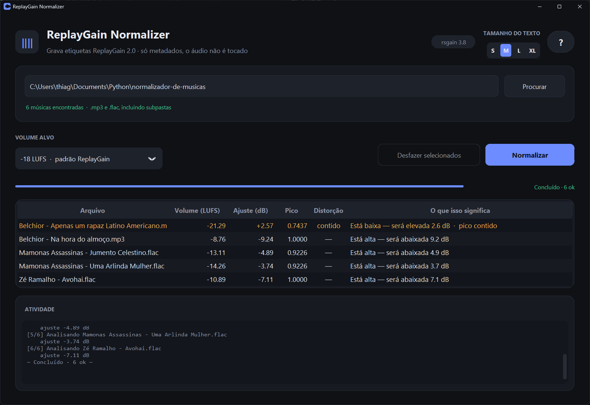

# ReplayGain Normalizer

A small dark-mode Windows desktop app that makes your music library play at a
consistent volume — without ever touching the audio.

It measures the perceived loudness of each `.mp3` / `.flac` and writes
**ReplayGain 2.0 tags** (`REPLAYGAIN_TRACK_GAIN`, `REPLAYGAIN_TRACK_PEAK`) into the
file's metadata. Your player reads those tags at playback time and adjusts the
volume on the fly. Nothing is re-encoded, and every change can be undone.



---

## What it does

**The interface is in Brazilian Portuguese.** This README stays in English; the app
itself speaks pt-BR, because it was built for a pt-BR user.

| | |
|---|---|
| **Point at a folder** | Drag it anywhere onto the window, or click *Procurar*. Subfolders are included. |
| **Pick a target** | `-18 LUFS` (ReplayGain standard), `-16`, or `-14` (streaming level). |
| **Normalizar** | One file at a time, with live progress, a results table and an activity log. |
| **Understand the result** | Every row ends with a plain-language sentence — *"Está alta — será abaixada 9.8 dB"* — so the raw LUFS and dB numbers never stand alone. |
| **Help** | The `?` button in the top-right explains every column: why LUFS is always negative, what the gain in dB does, what Peak and the clipping warning mean. |
| **Undo** | Select any rows in the table and remove their tags again. |

Formats: `.mp3` and `.flac`.

---

## Why this is safe

The audio stream is never decoded and re-encoded — only the metadata container is
rewritten. This was verified by comparing the audio before and after tagging:

- **FLAC** stores an MD5 of the *uncompressed* audio in its STREAMINFO block. It is
  byte-identical before and after.
- **MP3** MPEG frames (everything between the ID3 tags) hash identically before and
  after.

The file *size* does grow slightly, because the tags themselves take up space in the
container. That is metadata, not audio.

---

## Running from source

```bash
pip install -r requirements.txt
python tools/get_rsgain.py   # downloads the audio engine into rsgain/
python app.py
```

`rsgain/` is not committed to this repository — it is a 5 MB third-party binary with
its own license. The script above fetches the official
[rsgain 3.8](https://github.com/complexlogic/rsgain) Windows release and verifies it.

### Building the `.exe`

Double-click `build.bat`. The result is a single self-contained
`dist/ReplayGain Normalizer.exe` — the audio engine and the icon are bundled inside
it, so it runs from any folder, including a USB stick.

---

## Setting up your player

The app only *writes* the tags. Your player has to be told to *use* them.

### AIMP

1. Open **Preferences** (`Ctrl+P`).
2. Go to the **Sound Effects** section and find **Volume Normalization** →
   **Replay Gain**.
3. Enable Replay Gain, and make sure **"Use values from tags"** is ticked. Leave
   on-the-fly analysis **off** — that is the slow real-time fallback for files that
   have no tags, which is exactly the problem this app solves.
4. Set the mode to **Track** (not Album). This app writes track gain only.
5. If there is a **prevent clipping** option, leave it on.

> ⚠️ The exact wording and nesting of these options differs between AIMP 3, 4 and 5,
> and I could not verify AIMP 3's labels against official documentation (its manual is
> no longer published, and AIMP is not installed on the machine this was built on).
> The four settings above are what you are looking for; their exact menu path in your
> version may differ by a level or two.

### Other players

foobar2000, MusicBee, VLC, Rockbox and most Android players read these tags natively —
look for "ReplayGain" in their playback settings and set it to **track** mode.

---

## Known limitations

- **Undo changes the file's "date modified".** rsgain preserves mtimes when *writing*
  tags (`-p`), but not when deleting them. Measured, not assumed — see the note in
  `engine.remove_tags`.
- **No cancel button.** A run goes through to the end. At 10–100 files that is a few
  minutes at most.
- **Album gain is not supported** — track gain only, by design.
- **Locked files fail individually.** If your player has a song open, that one file
  gets an error row and the batch continues.

---

## Project layout

```
app.py                 CustomTkinter UI, queue polling, preferences
engine.py              file discovery, rsgain subprocess calls, output parsing
tools/get_rsgain.py    downloads the audio engine
tools/make_icon.py     generates assets/icon.ico from scratch (no Pillow)
build.bat              PyInstaller one-liner
```

`engine.py` imports no tkinter, so it can be run and tested from a plain terminal:

```bash
python engine.py "D:\Music"
```

Preferences (target loudness, last folder) live in
`%APPDATA%\ReplayGainNormalizer\config.json`.

---

## Credits

Audio analysis by [rsgain](https://github.com/complexlogic/rsgain) (v3.8), bundled at
build time. UI built with [CustomTkinter](https://github.com/TomSchimansky/CustomTkinter)
and [tkinterdnd2](https://github.com/pmgagne/tkinterdnd2).
